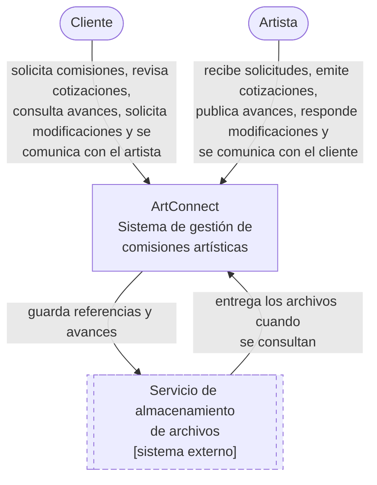
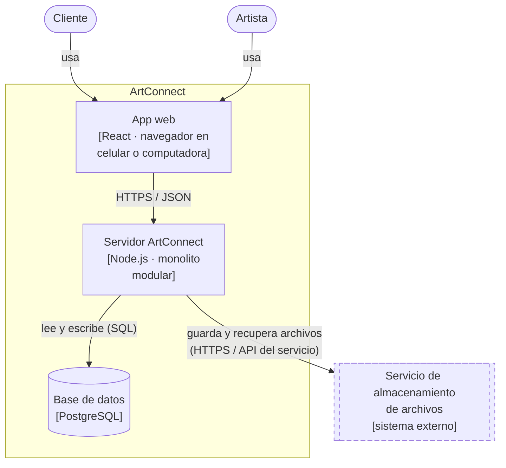
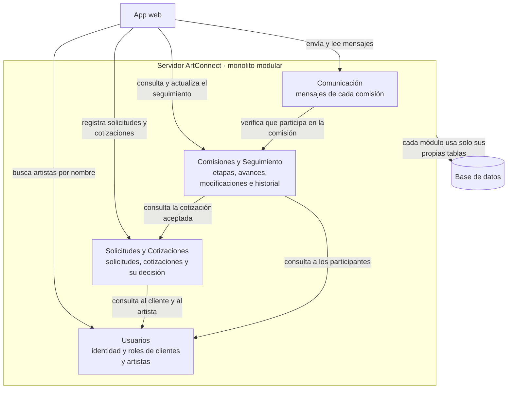
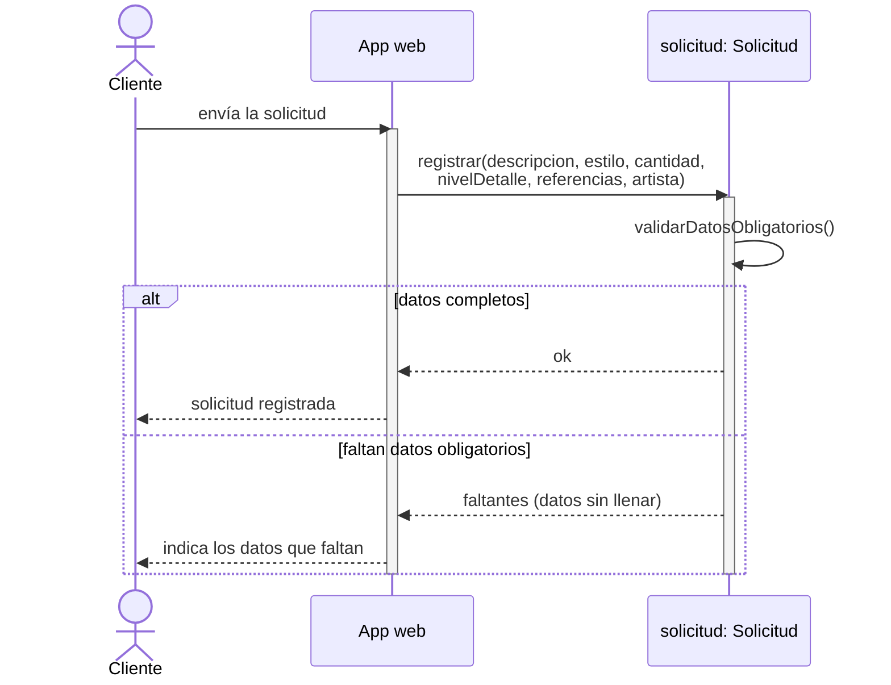
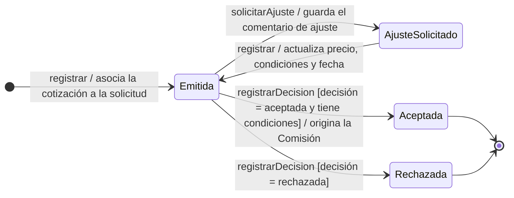

# Diagramas de mi sistema - ArtConnect

## 1. Diagrama de Contexto

---

## 2. Diagrama de Contenedores

---

## 3. Diagrama de Componentes

---

## 4. Diagrama de Clases

```mermaid
classDiagram
direction LR

class Usuario {
    -id: int
    -nombre: String
    -correo: String
    -roles: List~String~
    +crearSolicitud(solicitud: Solicitud) Solicitud
    +emitirCotizacion(solicitud: Solicitud, cotizacion: Cotizacion) void
    +enviarMensaje(comision: Comision, contenido: String) Mensaje
}

class Solicitud {
    -id: int
    -descripcion: String
    -estilo: String
    -cantidadElementos: int
    -nivelDetalle: String
    -referencias: String
    -fechaDeseada: Date
    -estado: String
    +registrar(descripcion: String, estilo: String, cantidad: int, nivelDetalle: String, referencias: String, artista: Usuario) void
    +actualizarEstado(nuevoEstado: String) void
    +validarDatosObligatorios() List~String~
}

class Cotizacion {
    -id: int
    -precio: Decimal
    -condiciones: String
    -fechaEntregaEstimada: Date
    -estado: String
    -comentarioAjuste: String
    +registrar(precio: Decimal, condiciones: String, fechaEntrega: Date) void
    +solicitarAjuste(comentario: String) void
    +registrarDecision(decision: String) void
}

class Comision {
    -id: int
    -fechaInicio: Date
    -estado: String
    -etapaActual: String
    +actualizarEtapa(nuevaEtapa: String) void
    +registrarAvance(avance: Avance) void
    +consultarHistorial() List~String~
}

class CondicionesTrabajo {
    -id: int
    -version: int
    -precio: Decimal
    -alcance: String
    -fechaEntrega: Date
    -fechaAcuerdo: Date
    -vigente: Boolean
    +crearVersion(precio: Decimal, alcance: String, fechaEntrega: Date) CondicionesTrabajo
    +marcarVigencia(vigente: Boolean) void
}

class Modificacion {
    -id: int
    -descripcion: String
    -fechaSolicitud: Date
    -estado: String
    -afectaPrecio: Boolean
    -afectaAlcance: Boolean
    -afectaFechaEntrega: Boolean
    +registrarSolicitud(descripcion: String) void
    +proponerCondiciones(condiciones: CondicionesTrabajo) void
    +registrarDecision(aceptada: Boolean) void
}

class Avance {
    -id: int
    -descripcion: String
    -etapa: String
    -fechaRegistro: Date
    +registrar(descripcion: String, etapa: String) void
}

class Mensaje {
    -id: int
    -contenido: String
    -fechaEnvio: Date
    -leido: Boolean
    +enviar(contenido: String) void
    +marcarComoLeido() void
}

Usuario "1" -- "0..*" Solicitud : registra como cliente
Usuario "1" -- "0..*" Cotizacion : emite como artista
Usuario "1" -- "0..*" Solicitud : recibe como artista
Solicitud "1" -- "0..1" Cotizacion : recibe
Cotizacion "1" -- "0..1" Comision : origina al aceptarse
Usuario "2" -- "0..*" Comision : participa como cliente y artista
Comision "1" *-- "0..*" Modificacion : contiene
Comision "1" *-- "0..*" Avance : contiene
Comision "1" *-- "0..*" Mensaje : contiene
Comision "1" *-- "1..*" CondicionesTrabajo : conserva versiones
Modificacion "0..1" -- "0..1" CondicionesTrabajo : puede proponer
```

---

## 5. Diagrama de Secuencia

---

## 6. Diagrama de Estados

